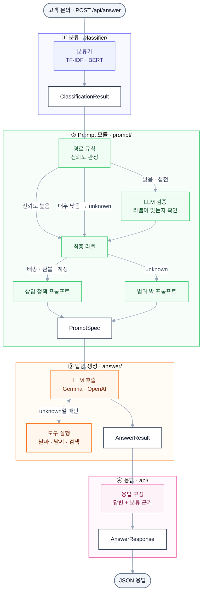

# Seal_LLM

한국어 고객 문의를 배송(shipping) · 환불(refund) · 계정(account)으로 분류하고, 분류 결과에 맞는 상담 정책으로
LLM이 답변 초안을 만드는 서비스입니다. 상담 범위 밖의 질문(unknown)은 날짜 · 날씨 · 검색 툴을 써서 답하고,
상담 범위를 함께 안내합니다.

## 전체 흐름



## 폴더 구조

```
Seal_LLM/
├─ src/theseal/
│  ├─ api/          FastAPI 서버 · LCEL 체인 (main.py · pipeline.py · schemas.py)
│  ├─ classifier/   분류 모델 학습 · 불러오기 · 예측 (Classifier · ClassificationResult)
│  ├─ prompt/       분류 후처리(router · route_rule · llm_verifier)와 프롬프트 생성(Prompt)
│  ├─ answer/       LLM 호출 · 툴 호출 반복 · 툴(tools/: 날짜 · 기상청 날씨 · Tavily 검색)
│  └─ common/       공용 설정(config) · LLM 연결(client) · 데이터 형식(schemas)
├─ scripts/
│  ├─ classifier/   분류기 다운로드 · 학습 · 비교 · test 평가
│  └─ answer/       로컬 LLM 다운로드 · 연결 확인 · 프롬프트 A/B 실험
├─ data/            교육용 한국어 합성 데이터 (inquiries · documents)
├─ runs/            실험 결과 (분류기 val_report · comparison.md, 프롬프트 A/B 결과). 가중치(model/)는 git 제외
├─ models/          받아 둔 사전학습 분류 모델 (git 제외)
├─ .env.example     비밀 키 · PC별 설정 견본
└─ pyproject.toml   의존성 (uv)
```

## 기술 스택

| 구분 | 사용 |
| --- | --- |
| 언어 · 환경 | Python 3.12, uv |
| API | FastAPI, Uvicorn, Pydantic |
| LLM 연결 | LangChain (LCEL), Ollama — Gemma 4 E4B (Q4_K_M), OpenAI — gpt-5.6-luna |
| 분류기 | scikit-learn (TF-IDF + 로지스틱 회귀), PyTorch · Transformers (klue/bert · roberta, KoELECTRA, mmBERT, NeoBERT 파인튜닝) |
| 툴 | 기상청 API허브 단기예보, Tavily 검색 |

## 빠르게 실행해 보기

[uv](https://docs.astral.sh/uv/)와 [Ollama](https://ollama.com/download)를 설치하고 Ollama를 실행해 둔 상태에서 시작합니다.

### 1. 패키지 · LLM 다운로드

```bash
uv sync
uv run scripts/answer/fetch_models.py
```

`fetch_models.py`는 로컬 LLM(Gemma 4 E4B, 약 6GB)을 Ollama로 받습니다.

### 2. 분류기 다운로드 · 학습 · 설정

```bash
uv run scripts/classifier/fetch_models.py
uv run python scripts/classifier/train_classifier_model.py
```

`scripts/classifier/fetch_models.py`는 번호로 고른 분류기 후보 모델을 `src/theseal/classifier/models/`에 받고,
`train_classifier_model.py`는 번호로 고른 모델을 파인튜닝합니다 (GPU 권장).
마지막에 출력되는 `runs/classifier/inquiries/<모델>/<실행 ID>/model`의 모델 이름과 실행 ID를
`src/theseal/classifier/config.py`의 `FINAL_MODEL`에 적습니다.

```python
FINAL_MODEL = {
    "inquiries": {"model": "<모델>", "run": "<실행 ID>"},
    ...
}
```

### 3. 서버 실행

```bash
uv run uvicorn --app-dir src theseal.api.main:app --host 127.0.0.1 --port 8000
```

### 4. 호출해 보기

```powershell
curl.exe -s http://127.0.0.1:8000/health
```

```powershell
curl.exe --% -s -X POST http://127.0.0.1:8000/api/answer -H "Content-Type: application/json" -d "{\"text\":\"사이즈가 맞지 않아 반품하려는데 환불은 언제 되나요?\"}"
```

`/health`의 `classifier`가 2단계에서 적은 모델이고 `classifier_error`가 `null`이면 준비 완료입니다.
`/api/answer` 응답의 `answer`가 답변입니다.
위 명령은 Windows PowerShell용입니다 (`--%`는 뒤의 따옴표를 그대로 넘기라는 뜻). 한글 요청이 실패하면
http://127.0.0.1:8000/docs 에서 `POST /api/answer` → **Try it out**으로 호출하세요.

### 5. (선택) 툴 호출 설정

배송 · 환불 · 계정 밖의 질문(unknown)은 LLM이 툴을 불러 답합니다. 날짜 툴은 설정 없이 동작하고,
날씨 · 검색 툴은 API 키가 있어야 켜집니다. 키가 없으면 그 툴만 빠지고 나머지는 그대로 동작합니다.

| 툴 | 필요한 키 | 키가 없으면 |
| --- | --- | --- |
| 날짜 · 요일 계산 | 없음 | - |
| 날씨 (기상청 API허브 단기예보) | `KMA_AUTH_KEY` | 날씨 질문에 검색 툴이 대신 답함 |
| 웹 검색 (Tavily) | `TAVILY_API_KEY` | 검색이 필요한 질문은 안내 문구로 답함 |

`.env.example`을 복사해 `.env`를 만들고 키를 채웁니다 (PowerShell은 `Copy-Item .env.example .env`).

```bash
cp .env.example .env
```

```dotenv
KMA_AUTH_KEY=<기상청 API허브 인증키>
TAVILY_API_KEY=<Tavily API 키>
```

키 설정을 확인하고 서버를 다시 켭니다 (`.env`는 서버를 켤 때만 읽습니다).

```bash
uv run scripts/answer/check_llm.py --kma --tavily
```

범위 밖 질문이 툴 경로(unknown)로 가는 기준은 아래 [분류 후처리 (routing)](#분류-후처리-routing)를 참고하세요.

## 개발 환경 세팅

```bash
uv run scripts/classifier/fetch_models.py
```

`fetch_models.py`는 후보를 번호로 보여 주고, 고른 모델만 `src/theseal/classifier/models/` 아래에 내려받습니다
(여러 개는 쉼표, 전부는 `a`). 후보 목록은 `src/theseal/classifier/config.py`의 `MODEL_CANDIDATES`에 있습니다.
이미 받은 모델은 건너뛰므로 여러 번 돌려도 안전합니다. 다시 받으려면 해당 폴더를 지우고 실행하세요.


## 분류기

분류기를 불러와 쓰는 방법과 직접 학습하는 순서는
[src/theseal/classifier/README.md](src/theseal/classifier/README.md)에 있습니다.

### LLM (답변 생성)

로컬 LLM은 Ollama로 돌립니다. 받는 방법은 위 "빠르게 실행해 보기" 1단계를 따릅니다.
연결과 키 설정은 `uv run scripts/answer/check_llm.py`로 확인합니다 (`--all`을 붙이면 OpenAI · 기상청 · Tavily도 실제로 호출, OpenAI는 과금).

`scripts/answer/fetch_models.py`는 `OLLAMA_MODEL`을 Ollama로 내려받고, 모델 ID가 팀 기준과 같은지
확인합니다. 모델은 분류기 모델 폴더(`src/theseal/classifier/models/`)가 아니라 Ollama 저장소(`~/.ollama`)에 저장됩니다.

| 구분 | 모델 | 용량 | 준비 |
| --- | --- | --- | --- |
| 로컬 | hf.co/unsloth/gemma-4-E4B-it-GGUF:Q4_K_M (ID `487eacf5e94b`) | 약 6GB | `fetch_models.py` |
| 상용 | OpenAI gpt-5.6-luna | - | `.env`에 `OPENAI_API_KEY` |
| 날씨 툴 | 기상청 API허브 단기예보 (지금 날씨 · 모레까지 예보) | - | `.env`에 `KMA_AUTH_KEY` (없으면 날씨 툴이 빠지고 검색 툴이 답함) |
| 검색 툴 | Tavily | - | `.env`에 `TAVILY_API_KEY` (없으면 검색 툴이 자동으로 빠짐) |

ID가 다르다는 경고가 나오면 Hugging Face 저장소 파일이 갱신된 것이므로 팀에 알려 주세요.

### 분류 후처리 (routing)

`src/theseal/prompt/router.py`의 `Router`가 분류기 결과를 받아 최종 라벨을 정합니다. 분류기 확률에서 p1 · margin을 구해
`route_rule.py`의 `RouteRule`(기준선과 비교 규칙만 있음)로 확신(confident) · 확신 아님(ambiguous) · 모름(unknown)을 판정하고,
확신이 아닌 문의는 LLM 검증이 라벨이 맞는지 한 번 더 확인합니다.
입력은 `Classifier.predict()` 결과(`ClassificationResult`) 하나입니다. 원문은 결과의 `text`, 라벨 이름은 task의 `labels.json` 순서입니다.

```python
clf = Classifier.from_final()
router = Router.from_env()                    # labels.json · .env · 고정 기준선 RULE
result = await router.run(clf.predict(text))  # 원문은 result.text
result.label  # 최종 라벨 (shipping · refund · account · unknown) → 프롬프트 생성
```

기준선은 분류 모델과 상관없이 `router.py`의 `RULE` 하나로 고정합니다 (tau 0.60 · tau_low 0.45 · delta 0.15).
모델별로 다른 기준선이 필요해지면 그때 확장합니다.

켜고 끄기는 `.env`에서 합니다.

| 항목 | `.env` | 값 |
| --- | --- | --- |
| 경로 규칙 | `ROUTE_RULE_ENABLED` | `true` (기본) · `false` |
| LLM 검증 | `VERIFY_MODE` | `uncertain` (기본, 확신이 아닌 것만) · `all` (전부) · `off` |

둘 다 끄면 분류기 라벨을 그대로 씁니다.

### API 서버 (FastAPI)

분류 → 분류 후처리 → 프롬프트 → 답변 생성을 HTTP로 묶은 서버입니다. 분류 모델은 `classifier/config.py`의
`FINAL_MODEL`이 가리키는 `runs/classifier/<task>/<모델>/<실행 ID>/model/`을 씁니다. 모델이 없어도 서버는 뜨고,
`/health`에 이유가 나옵니다. 모델 준비와 서버 실행은 위 "빠르게 실행해 보기" 2 · 3단계를 따릅니다.

| 메서드 | 경로 | 내용 |
| --- | --- | --- |
| GET | `/health` | 서버 상태 · 분류 모델 · 설정 |
| POST | `/api/answer` | `{"text", "provider"?, "label"?}` → 답변 + 분류 결과 (JSON) |
| POST | `/api/answer/stream` | 같은 요청 → SSE (`status` · `classification` · `delta` · `done`). 범위 밖(unknown)은 툴을 쓴 뒤 `done`만 보냄 |

`provider`는 `local` · `openai`(비우면 `DEFAULT_PROVIDER`, 기본 `local`), `label`을 넣으면 분류를 건너뜁니다.

#### 응답 예시 (`POST /api/answer`)

요청: `{"text": "사이즈가 맞지 않아 반품하려는데 환불은 언제 되나요?"}`

```json
{
  "status": "ok",
  "label": "refund",
  "answer": "반품을 원하시는군요. 먼저 반품 접수를 하셨는지 확인해 주시겠어요? … 상품을 수령하신 날로부터 7일 이내에 반품을 접수하셔야 한다는 가상 기준이 있습니다. …",
  "provider": "local",
  "model": "hf.co/unsloth/gemma-4-E4B-it-GGUF:Q4_K_M",
  "prompt_version": "common-policy-v1",
  "tools_used": [],
  "latency_ms": 5167,
  "usage": {"input_tokens": 297, "output_tokens": 202},
  "error": null,
  "classification": {
    "label": "refund",
    "classifier_label": "refund",
    "scores": {"shipping": 0.1025, "refund": 0.7776, "account": 0.1199},
    "route": {"route": "confident", "p1": 0.7776, "margin": 0.6577, "tau": 0.6, "…": "…"},
    "verification": null
  }
}
```

| 필드 | 내용 |
| --- | --- |
| `answer` | 답변. 오류면 `null` |
| `label` | 최종 라벨 (shipping · refund · account · unknown) |
| `prompt_version` | 사용한 프롬프트 (`common-policy-v1`, `unknown-v1-…`) |
| `tools_used` | unknown 질문에서 호출한 툴과 결과 성공 여부 |
| `classification` | 분류 근거: 분류기 확률(`scores`), 판정 경로(`route`), LLM 검증(`verification`, 확신일 때는 생략돼 `null`) |
| `status` · `error` | 오류가 나도 같은 형식으로 `status: "error"`와 `error.code` (`invalid_input` · `config_error` · `llm_error` · `llm_timeout`) |
